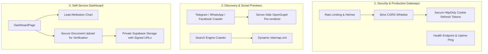

# Technical Guide: Dashboard Polish, Security Hardening, SEO & Production DevOps
**Assignee:** Dashboard, Security & DevOps Engineer (Developer 3)  
**Platform:** GebetaPro (Web-Based SaaS Local Discovery & Directory)  
**Priority:** High / Pre-Launch Sprint  

---

## Mission Overview

Your mission is to make the platform **secure against attacks**, **optimized for viral social sharing**, **reliable in production**, and provide business owners with a high-converting **self-management dashboard**.



---

## Task 1: Dynamic OpenGraph Metadata Pre-renderer for Social Sharing

### 1. The Problem
When a user shares a link on Telegram, WhatsApp, Facebook, or Twitter:
`https://gebetapro.com/@dr-abebe-clinic`
Social media bots (e.g. `TelegramBot`, `WhatsApp/2.x`, `facebookexternalhit`, `Twitterbot`) make an HTTP `GET` request and inspect the initial HTML for `<meta property="og:...">` tags.  
Because this is a Single Page Application (React + Vite), the bot only sees the default `index.html` title ("GebetaPro"), resulting in **no image, no business name, and poor click-through rates**.

### 2. Architecture & Edge / Express Pre-renderer
Add an Express / Cloudflare Worker handler that intercepts requests from social bots to `/@:slug`:

```javascript
// backend/src/modules/profiles/profiles.og.js
import db from '../../db/index.js';

const SOCIAL_BOT_REGEX = /facebookexternalhit|Facebot|Twitterbot|TelegramBot|WhatsApp|LinkedInBot|Slackbot/i;

export async function handleSocialSharePreview(req, res, next) {
  const userAgent = req.headers['user-agent'] || '';
  const isBot = SOCIAL_BOT_REGEX.test(userAgent);

  // If request is from normal browser, let SPA handle it
  if (!isBot) {
    return next();
  }

  const slug = req.params.slug?.replace(/^@/, '');
  try {
    const { rows } = await db.query(
      `SELECT p.display_name, p.headline, p.avatar_url, p.cover_image_url, p.city, c.name as category_name
       FROM profiles p
       LEFT JOIN categories c ON c.id = p.category_id
       WHERE p.slug = $1 AND p.is_published = TRUE`,
      [slug]
    );

    if (rows.length === 0) {
      return next();
    }

    const profile = rows[0];
    const title = `${profile.display_name} - ${profile.category_name || 'Professional'} in ${profile.city || 'Ethiopia'}`;
    const description = profile.headline || `Connect with ${profile.display_name} on GebetaPro. View portfolio, reviews, working hours, and contact details.`;
    const image = profile.cover_image_url || profile.avatar_url || 'https://gebetapro.com/og-default.jpg';
    const profileUrl = `https://gebetapro.com/@${slug}`;

    const html = `<!DOCTYPE html>
<html lang="en">
<head>
  <meta charset="UTF-8">
  <title>${escapeHtml(title)}</title>
  <meta name="description" content="${escapeHtml(description)}">

  <!-- OpenGraph / Facebook / WhatsApp / Telegram -->
  <meta property="og:type" content="profile">
  <meta property="og:url" content="${profileUrl}">
  <meta property="og:title" content="${escapeHtml(title)}">
  <meta property="og:description" content="${escapeHtml(description)}">
  <meta property="og:image" content="${image}">
  <meta property="og:site_name" content="GebetaPro">

  <!-- Twitter -->
  <meta name="twitter:card" content="summary_large_image">
  <meta name="twitter:title" content="${escapeHtml(title)}">
  <meta name="twitter:description" content="${escapeHtml(description)}">
  <meta name="twitter:image" content="${image}">
</head>
<body>
  <h1>${escapeHtml(title)}</h1>
  <p>${escapeHtml(description)}</p>
  <a href="${profileUrl}">View Profile on GebetaPro</a>
</body>
</html>`;

    return res.status(200).send(html);
  } catch (err) {
    return next();
  }
}

function escapeHtml(str) {
  return (str || '').replace(/[&<>"']/g, (m) => ({
    '&': '&amp;',
    '<': '&lt;',
    '>': '&gt;',
    '"': '&quot;',
    "'": '&#39;',
  }[m]));
}
```

---

## Task 2: Dynamic `/sitemap.xml` & `robots.txt`

### 1. Objective
Ensure Google and Bing index all published profiles and categories automatically.

### 2. Implementation (`backend/src/modules/health/sitemap.controller.js`)
Expose `GET /sitemap.xml` directly from the backend:

```javascript
import db from '../../db/index.js';

export async function generateSitemap(req, res) {
  const { rows: profiles } = await db.query(
    `SELECT slug, updated_at FROM profiles WHERE is_published = TRUE AND status = 'ACTIVE' ORDER BY updated_at DESC LIMIT 5000`
  );

  const { rows: categories } = await db.query(
    `SELECT slug, updated_at FROM categories WHERE is_active = TRUE`
  );

  const baseUrl = 'https://gebetapro.com';

  const xmlUrls = [
    `  <url><loc>${baseUrl}/</loc><changefreq>daily</changefreq><priority>1.0</priority></url>`,
    `  <url><loc>${baseUrl}/directory</loc><changefreq>hourly</changefreq><priority>0.9</priority></url>`,
    `  <url><loc>${baseUrl}/pricing</loc><changefreq>monthly</changefreq><priority>0.7</priority></url>`,
  ];

  // Add categories
  for (const cat of categories) {
    xmlUrls.push(
      `  <url><loc>${baseUrl}/directory?category=${cat.slug}</loc><changefreq>daily</changefreq><priority>0.8</priority></url>`
    );
  }

  // Add active profile handles
  for (const p of profiles) {
    const lastMod = new Date(p.updated_at).toISOString().split('T')[0];
    xmlUrls.push(
      `  <url><loc>${baseUrl}/@${p.slug}</loc><lastmod>${lastMod}</lastmod><changefreq>weekly</changefreq><priority>0.8</priority></url>`
    );
  }

  const sitemapXml = `<?xml version="1.0" encoding="UTF-8"?>
<urlset xmlns="http://www.sitemaps.org/schemas/sitemap/0.9">
${xmlUrls.join('\n')}
</urlset>`;

  res.header('Content-Type', 'application/xml');
  res.header('Cache-Control', 'public, max-age=86400'); // Cache 24 hours
  res.status(200).send(sitemapXml);
}
```

---

## Task 3: Security Hardening & Rate Limiting

### 1. The Problem
An unhardened API is vulnerable to password brute-forcing, spam registration bots, and credential stuffing.

### 2. Rate Limiting Setup (`backend/src/middleware/rateLimiter.js`)
Install and configure `express-rate-limit`:

```bash
npm install express-rate-limit
```

```javascript
// backend/src/middleware/rateLimiter.js
import rateLimit from 'express-rate-limit';

// Global API limiter (e.g., 300 requests per 15 minutes per IP)
export const apiLimiter = rateLimit({
  windowMs: 15 * 60 * 1000,
  max: 300,
  message: {
    success: false,
    message: 'Too many requests from this IP, please try again later.',
    error: { code: 'RATE_LIMIT_EXCEEDED' }
  },
  standardHeaders: true,
  legacyHeaders: false,
});

// Strict Auth limiter: Max 5 failed attempts per 15 mins for login / password-reset
export const authLimiter = rateLimit({
  windowMs: 15 * 60 * 1000,
  max: 10,
  message: {
    success: false,
    message: 'Too many authentication attempts. Please wait 15 minutes before trying again.',
    error: { code: 'AUTH_RATE_LIMIT' }
  },
  standardHeaders: true,
  legacyHeaders: false,
});
```

Mount `authLimiter` in `backend/src/modules/auth/auth.routes.js`:
```javascript
router.post('/login', authLimiter, validate(loginSchema), controller.login);
router.post('/register', authLimiter, validate(registerSchema), controller.register);
router.post('/forgot-password', authLimiter, validate(forgotPasswordSchema), controller.forgotPassword);
```

### 3. Strict CORS & Cookie Security
In `backend/src/app.js`:
```javascript
const allowedOrigins = [
  'https://gebetapro.com',
  'https://www.gebetapro.com',
  'https://admin.gebetapro.com',
  ...(config.isDevelopment ? ['http://localhost:5173', 'http://localhost:3000'] : [])
];

const corsOptions = {
  origin(origin, callback) {
    if (!origin || allowedOrigins.includes(origin)) {
      return callback(null, true);
    }
    return callback(new Error('Blocked by CORS policy'));
  },
  credentials: true, // Needed for HttpOnly refresh cookies
};
```

---

## Task 4: Secure KYC Document Handling & Signed URLs

### 1. Security Requirement
In `037_create_verification_documents.sql`, user IDs and business licenses are stored in Supabase Storage.
- **Never make the `verification-docs` bucket public.**
- Only admins and the profile owner can view the document.
- Generate a temporary **Signed URL** with an expiration time of 15 minutes when viewing documents in the admin panel.

### 2. Backend Implementation (`backend/src/utils/storage.js`)
```javascript
import { supabase } from './supabase.js';

/**
 * Generate temporary signed download/view URL for private verification documents
 * @param {string} storageKey - Path within private bucket (e.g. verification-docs/...)
 * @param {number} expiresIn - Seconds until URL expires (default: 900s / 15 mins)
 */
export async function getPrivateSignedUrl(storageKey, expiresIn = 900) {
  const { data, error } = await supabase.storage
    .from('verification-docs')
    .createSignedUrl(storageKey, expiresIn);

  if (error) {
    throw new Error(`Failed to generate signed URL: ${error.message}`);
  }
  return data.signedUrl;
}
```

In `backend/src/modules/admin/admin.service.js`:
```javascript
export async function getProfileVerificationDetail(profileId) {
  const detail = await adminRepo.getVerificationDetailByProfileId(profileId);
  if (detail?.verification_document?.storage_key) {
    // Generate secure 15-minute signed URL
    detail.verification_document.signed_url = await getPrivateSignedUrl(
      detail.verification_document.storage_key,
      900
    );
  }
  return detail;
}
```

---

## Task 5: Provider Dashboard Lead Attribution Chart & Plan Limits UX

### 1. The Problem
Inside `DashboardPage.jsx`, providers see total numbers, but they cannot see **which channels give them the most leads** (e.g., Did 15 people call, or did 30 people chat on WhatsApp?). Showing this breakdown justifies their monthly subscription.

### 2. Enhanced Stat & Lead Attribution Component
In `frontend/src/pages/DashboardPage.jsx`:

```jsx
function LeadBreakdownCard({ analytics }) {
  const events = analytics?.breakdown || {
    WHATSAPP_CLICK: 0,
    PHONE_CLICK: 0,
    TELEGRAM_CLICK: 0,
    WEBSITE_CLICK: 0,
  };

  const totalLeads = 
    events.WHATSAPP_CLICK + events.PHONE_CLICK + events.TELEGRAM_CLICK + events.WEBSITE_CLICK;

  return (
    <div className="bg-surface border border-border rounded-2xl p-5 space-y-4">
      <div className="flex items-center justify-between">
        <div>
          <h3 className="text-sm font-bold text-ink">Inquiry Channels (Last 30 Days)</h3>
          <p className="text-xs text-ink-3">Where your clients contact you from</p>
        </div>
        <span className="text-lg font-extrabold text-emerald-600">
          {totalLeads} total leads
        </span>
      </div>

      <div className="grid grid-cols-2 sm:grid-cols-4 gap-3 pt-2">
        <div className="p-3 rounded-xl bg-emerald-500/10 border border-emerald-500/20 text-center">
          <span className="text-xs font-semibold text-emerald-700 block">WhatsApp</span>
          <span className="text-xl font-bold text-emerald-800">{events.WHATSAPP_CLICK}</span>
        </div>
        <div className="p-3 rounded-xl bg-blue-500/10 border border-blue-500/20 text-center">
          <span className="text-xs font-semibold text-blue-700 block">Phone Calls</span>
          <span className="text-xl font-bold text-blue-800">{events.PHONE_CLICK}</span>
        </div>
        <div className="p-3 rounded-xl bg-sky-500/10 border border-sky-500/20 text-center">
          <span className="text-xs font-semibold text-sky-700 block">Telegram</span>
          <span className="text-xl font-bold text-sky-800">{events.TELEGRAM_CLICK}</span>
        </div>
        <div className="p-3 rounded-xl bg-purple-500/10 border border-purple-500/20 text-center">
          <span className="text-xs font-semibold text-purple-700 block">Website</span>
          <span className="text-xl font-bold text-purple-800">{events.WEBSITE_CLICK}</span>
        </div>
      </div>
    </div>
  );
}
```

---

## Developer 3 Checklist & Acceptance Criteria

- [ ] **OpenGraph Link Previews**: Testing `curl -A "TelegramBot" https://gebetapro.com/@slug` returns complete HTML with `og:title`, `og:image`, and `og:description`.
- [ ] **Dynamic Sitemap**: Visiting `/sitemap.xml` generates valid XML listing all public profile handles with `<lastmod>` timestamps.
- [ ] **Auth Rate Limiting**: Sending more than 10 rapid login attempts from Postman triggers HTTP 429 (`RATE_LIMIT_EXCEEDED`).
- [ ] **Private KYC Signed URLs**: Uploaded business documents are kept in a private bucket and loaded in `AdminVerificationsPage.jsx` via temporary signed URLs.
- [ ] **Dashboard Leads Breakdown**: The provider dashboard displays the visual card dividing contact inquiries into WhatsApp, Phone, Telegram, and Website clicks.
