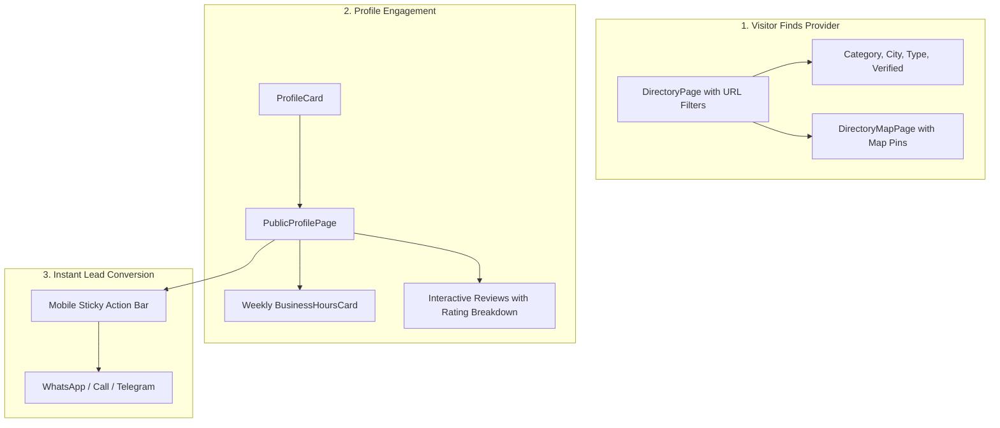

# Technical Guide: Frontend Discovery, Reviews & Conversion Polish
**Assignee:** Frontend & UX Engineer (Developer 1)  
**Platform:** GebetaPro (Web-Based SaaS Local Discovery & Directory)  
**Priority:** High / Pre-Launch Sprint  

---

## Mission Overview

Your goal is to complete the **public-facing visitor experience** so that finding, viewing, and contacting service providers and local businesses is fast, intuitive, responsive, and drives maximum inquiries.



---

## Task 1: Directory URL Filter Synchronization & Empty State Polish

### 1. The Problem
Visitors sharing a link like `gebetapro.com/directory?category=plumber&city=Addis%20Ababa` must see the exact filtered results. Currently, filter state inside `DirectoryPage.jsx` does not stay 100% in sync with URL search params across browser back/forward buttons, and empty states don't guide visitors on what to do next.

### 2. Implementation Specifications (`frontend/src/pages/DirectoryPage.jsx`)

#### A. URL Query Param Synchronization
Ensure bidirectional binding between `useSearchParams` and filter state:

```javascript
import { useSearchParams } from 'react-router-dom';

export function useDirectoryFilters() {
  const [searchParams, setSearchParams] = useSearchParams();

  const filters = {
    search: searchParams.get('q') || '',
    category_id: searchParams.get('category') || '',
    city: searchParams.get('city') || '',
    profile_type: searchParams.get('type') || '',
    is_verified: searchParams.get('verified') === 'true',
    sort: searchParams.get('sort') || 'featured',
    page: parseInt(searchParams.get('page') || '1', 10),
  };

  const updateFilters = (newFilters) => {
    setSearchParams((prev) => {
      const updated = new URLSearchParams(prev);
      Object.entries(newFilters).forEach(([key, value]) => {
        if (value === '' || value === false || value === null || value === undefined) {
          updated.delete(key);
        } else {
          updated.set(key, String(value));
        }
      });
      // Reset page to 1 when any filter other than page changes
      if (!newFilters.page) {
        updated.set('page', '1');
      }
      return updated;
    });
  };

  const resetFilters = () => {
    setSearchParams(new URLSearchParams());
  };

  return { filters, updateFilters, resetFilters };
}
```

#### B. High-Converting Empty State Component
When `profiles.length === 0`, display a custom empty state rather than just "No results found":

```jsx
function DirectoryEmptyState({ onReset, hasFilters }) {
  return (
    <div className="text-center py-16 px-4 bg-surface rounded-2xl border border-dashed border-border">
      <div className="w-16 h-16 mx-auto mb-4 rounded-full bg-primary/10 flex items-center justify-center text-primary">
        <SearchX className="w-8 h-8" />
      </div>
      <h3 className="text-lg font-bold text-ink mb-1">No professionals found</h3>
      <p className="text-sm text-ink-2 max-w-md mx-auto mb-6">
        We couldn't find any profiles matching your exact criteria. Try broadening your location or clearing filters.
      </p>

      <div className="flex flex-wrap items-center justify-center gap-3">
        {hasFilters && (
          <button onClick={onReset} className="btn-secondary">
            Clear all filters
          </button>
        )}
        <Link to="/register" className="btn-primary">
          Are you in this business? Join GebetaPro
        </Link>
      </div>
    </div>
  );
}
```

---

## Task 2: Repurpose `AdsMapPage.jsx` into `DirectoryMapPage.jsx`

### 1. The Problem
`AppRoutes.jsx` currently contains:
```javascript
const DirectoryMapPage = lazy(() => import('../pages/AdsMapPage.jsx')) // repurposed
```
`AdsMapPage.jsx` is full of old marketplace listing logic (fetching `/api/ads`, rendering price tags, "condition: new/used", etc.). It must be replaced with a clean `DirectoryMapPage.jsx` that plots **service providers and businesses**.

### 2. Implementation Specifications (`frontend/src/pages/DirectoryMapPage.jsx`)

1. **Delete / Replace:** Replace `frontend/src/pages/AdsMapPage.jsx` with `frontend/src/pages/DirectoryMapPage.jsx`.
2. **Update Route:** In `frontend/src/routes/AppRoutes.jsx`:
   ```javascript
   const DirectoryMapPage = lazy(() => import('../pages/DirectoryMapPage.jsx'));
   ```
3. **Map Marker Details:** When a user clicks a marker pin on the map, render a popup card with:
   - Avatar & Display Name
   - Category Badge
   - Verified Shield (if `is_verified`)
   - City & Country
   - Star Rating (e.g. `★ 4.8 (19)`)
   - "View Profile" link navigating to `/@{slug}`
   - Direct "Chat on WhatsApp" button

```jsx
// Example Leaflet/MapLibre Popup Content:
<Popup>
  <div className="w-56 p-2 space-y-2">
    <div className="flex items-center gap-2">
      
      <div>
        <h4 className="font-bold text-xs line-clamp-1">{provider.display_name}</h4>
        <span className="text-[10px] text-primary font-medium">{provider.category_name}</span>
      </div>
    </div>
    <div className="flex items-center justify-between pt-1 border-t border-border text-[11px]">
      <span className="text-ink-2 font-medium">{provider.city}</span>
      <Link to={`/@${provider.slug}`} className="text-primary font-semibold hover:underline">
        View Profile →
      </Link>
    </div>
  </div>
</Popup>
```

---

## Task 3: Standalone Weekly `BusinessHoursCard.jsx` Component

### 1. The Problem
Customers need to know:
1. Is this business open **right now**?
2. What time do they close today?
3. What are their hours for the rest of the week?

Currently, `ProfileAbout.jsx` has scattered logic and there is no standalone, reusable weekly hours schedule card.

### 2. Create Component (`frontend/src/features/profiles/components/BusinessHoursCard.jsx`)

```jsx
import React from 'react';
import { Clock, CheckCircle2, XCircle } from 'lucide-react';
import { 
  evaluateBusinessStatus, 
  format24to12, 
  getCurrentTimeInZone 
} from '../../../utils/businessHours.js';

const DAYS = [
  { dayIndex: 1, name: 'Monday' },
  { dayIndex: 2, name: 'Tuesday' },
  { dayIndex: 3, name: 'Wednesday' },
  { dayIndex: 4, name: 'Thursday' },
  { dayIndex: 5, name: 'Friday' },
  { dayIndex: 6, name: 'Saturday' },
  { dayIndex: 0, name: 'Sunday' },
];

export function BusinessHoursCard({ businessHours }) {
  if (!businessHours || businessHours.length === 0) {
    return null;
  }

  const currentDayIndex = getCurrentTimeInZone().day;
  const status = evaluateBusinessStatus(businessHours);

  // Map hours by day_of_week for O(1) lookup
  const hoursMap = new Map();
  businessHours.forEach((item) => hoursMap.set(item.day_of_week, item));

  return (
    <div className="bg-surface border border-border rounded-2xl p-5 shadow-sm space-y-4">
      {/* Header with live status pill */}
      <div className="flex items-center justify-between pb-3 border-b border-border">
        <div className="flex items-center gap-2">
          <Clock className="w-5 h-5 text-primary" />
          <h3 className="font-bold text-ink text-sm">Opening Hours</h3>
        </div>
        
        {status && (
          <span className={`inline-flex items-center gap-1.5 px-2.5 py-1 rounded-full text-xs font-semibold ${
            status.open ? 'bg-emerald-50 text-emerald-700' : 'bg-rose-50 text-rose-700'
          }`}>
            <span className={`w-2 h-2 rounded-full ${status.open ? 'bg-emerald-500 animate-pulse' : 'bg-rose-500'}`} />
            {status.open ? 'Open Now' : 'Closed'}
          </span>
        )}
      </div>

      {/* 7-Day Schedule List */}
      <div className="space-y-2 text-xs">
        {DAYS.map(({ dayIndex, name }) => {
          const dayData = hoursMap.get(dayIndex);
          const isToday = currentDayIndex === dayIndex;

          let displayTime = 'Closed';
          if (dayData && !dayData.is_closed) {
            displayTime = `${format24to12(dayData.opens_at)} - ${format24to12(dayData.closes_at)}`;
          }

          return (
            <div 
              key={dayIndex}
              className={`flex items-center justify-between py-1.5 px-2 rounded-lg transition-colors ${
                isToday ? 'bg-primary/10 font-bold text-primary' : 'text-ink-2'
              }`}
            >
              <div className="flex items-center gap-2">
                <span>{name}</span>
                {isToday && <span className="text-[10px] uppercase tracking-wide bg-primary text-white px-1.5 py-0.2 rounded font-bold">Today</span>}
              </div>
              <span className={dayData?.is_closed ? 'text-ink-3' : 'font-medium'}>
                {displayTime}
              </span>
            </div>
          );
        })}
      </div>
    </div>
  );
}
```

---

## Task 4: Reviews UX Polish & Rating Breakdown Bars

### 1. The Problem
Reviews give visitors confidence to book or call. In `ReviewsList.jsx`, there is only a raw average number (e.g. "4.2"). It lacks the standard **Rating Distribution Bar Chart** (e.g. 5 stars = 75%, 4 stars = 15%, etc.) seen on Amazon, Google, and Airbnb, and doesn't handle the "User has already submitted a review" state gracefully.

### 2. Implement Rating Breakdown (`RatingBreakdownBar.jsx`)
In `frontend/src/features/profiles/components/ReviewsList.jsx`, enhance `RatingSummary`:

```jsx
function RatingBreakdown({ stats }) {
  const total = stats?.review_count || 0;
  const distribution = stats?.distribution || { 5: 0, 4: 0, 3: 0, 2: 0, 1: 0 };

  return (
    <div className="space-y-1.5 w-full max-w-xs text-xs">
      {[5, 4, 3, 2, 1].map((stars) => {
        const count = distribution[stars] || 0;
        const percentage = total > 0 ? Math.round((count / total) * 100) : 0;

        return (
          <div key={stars} className="flex items-center gap-2">
            <span className="w-8 text-ink-2 font-medium">{stars} ★</span>
            <div className="flex-1 h-2 bg-surface-3 rounded-full overflow-hidden">
              <div 
                className="h-full bg-yellow-400 rounded-full transition-all duration-500" 
                style={{ width: `${percentage}%` }}
              />
            </div>
            <span className="w-8 text-right text-ink-3 font-medium">{count}</span>
          </div>
        );
      })}
    </div>
  );
}
```

### 3. Business Owner Reply Styling
When a profile owner replies to a customer review, display a distinct indented badge in `ReviewCard.jsx`:

```jsx
{review.owner_reply && (
  <div className="mt-3 ml-4 pl-3 border-l-2 border-primary/40 bg-surface-2 p-3 rounded-r-xl">
    <div className="flex items-center gap-1.5 mb-1">
      <span className="text-xs font-bold text-ink">Response from {profileName}</span>
      <span className="text-[10px] text-ink-3">({formatDate(review.owner_reply_date)})</span>
    </div>
    <p className="text-xs text-ink-2 leading-relaxed">{review.owner_reply}</p>
  </div>
)}
```

---

## Task 5: Mobile Sticky Action Bar for Instant Leads

### 1. The Problem
Over 75% of marketplace and directory traffic in Ethiopia and emerging markets arrives via mobile smartphones. When a visitor scrolls through services or portfolio items on `PublicProfilePage.jsx`, the "Call" and "WhatsApp" buttons disappear off the top of the screen.

### 2. Create Component (`frontend/src/features/profiles/components/MobileStickyActions.jsx`)

```jsx
import React from 'react';
import { Phone, MessageCircle, Send, MapPin } from 'lucide-react';

export function MobileStickyActions({ profile, onActionClick }) {
  if (!profile) return null;

  const phone = profile.phone?.replace(/[^0-9]/g, '');
  const telegram = profile.telegram_username?.replace('@', '');

  return (
    <div className="md:hidden fixed bottom-0 left-0 right-0 z-40 bg-surface/95 backdrop-blur-md border-t border-border p-3 shadow-lg flex items-center gap-2 safe-area-pb">
      {/* Call button */}
      {phone && (
        <a 
          href={`tel:${phone}`}
          onClick={() => onActionClick('PHONE_CLICK')}
          className="flex-1 bg-surface-2 border border-border text-ink font-bold text-xs py-2.5 rounded-xl flex items-center justify-center gap-1.5 active:scale-95 transition-transform"
        >
          <Phone className="w-4 h-4 text-emerald-600" />
          Call
        </a>
      )}

      {/* WhatsApp Button */}
      {phone && (
        <a
          href={`https://wa.me/${phone}?text=${encodeURIComponent(`Hi ${profile.display_name}, I saw your profile on GebetaPro.`)}`}
          target="_blank"
          rel="noopener noreferrer"
          onClick={() => onActionClick('WHATSAPP_CLICK')}
          className="flex-1 bg-emerald-600 hover:bg-emerald-700 text-white font-bold text-xs py-2.5 rounded-xl flex items-center justify-center gap-1.5 active:scale-95 transition-transform shadow-sm"
        >
          <MessageCircle className="w-4 h-4" />
          WhatsApp
        </a>
      )}

      {/* Telegram Button (if no phone or extra action) */}
      {telegram && (
        <a
          href={`https://t.me/${telegram}`}
          target="_blank"
          rel="noopener noreferrer"
          onClick={() => onActionClick('TELEGRAM_CLICK')}
          className="p-2.5 bg-sky-500 hover:bg-sky-600 text-white rounded-xl flex items-center justify-center active:scale-95 transition-transform shadow-sm"
          title="Chat on Telegram"
        >
          <Send className="w-4 h-4" />
        </a>
      )}
    </div>
  );
}
```

Add this component right before the closing tag of `PublicProfilePage.jsx`.

---

## Developer 1 Checklist & Acceptance Criteria

- [ ] **Directory URL Synchronization**: Changing filters updates the browser URL bar. Copying and opening the URL in a new private window loads identical results.
- [ ] **Empty State**: Searching an impossible query (e.g. `xyz999`) renders the friendly empty state with a working "Clear filters" button.
- [ ] **Directory Map Refactor**: `AdsMapPage.jsx` is deleted and replaced with `DirectoryMapPage.jsx` showing interactive pins of registered businesses.
- [ ] **Weekly Business Hours**: `BusinessHoursCard.jsx` accurately highlights the current day of the week and shows the live green "Open Now" / red "Closed" badge.
- [ ] **Review Ratings Breakdown**: Five-star breakdown bars display correct percentages and count in `ReviewsList.jsx`.
- [ ] **Mobile Sticky Bar**: Loading any profile on mobile viewports shows the sticky Call & WhatsApp buttons fixed to the bottom of the screen.
