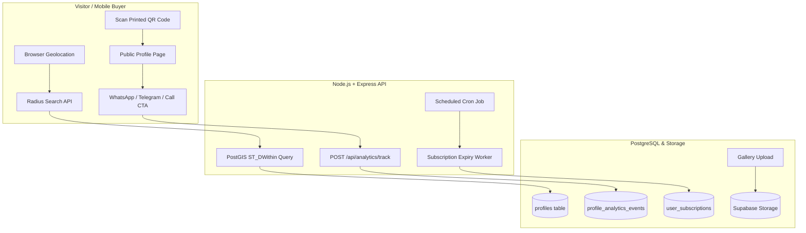
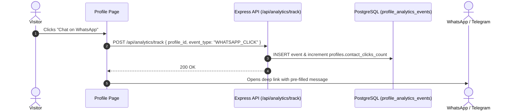

# Technical Guide: Part 2 — Critical Unstarted Features & Automations
**Platform:** GebetaPro (Web-Based SaaS Local Discovery & Professional Directory)  
**Audience:** Development Team (Backend, Frontend, Fullstack Engineers)  
**Target Delivery:** Pre-Launch Sprint  

---

## Executive Summary

This document specifies the exact technical architecture, data contracts, database queries, and frontend integrations for the **5 critical features** identified in Part 2 that have not yet been implemented or wired end-to-end:

1. **Task 2.1:** 📍 PostGIS Radius Search ("Professionals Near Me")
2. **Task 2.2:** 📲 Instant WhatsApp & Telegram Lead Actions with Event Attribution
3. **Task 2.3:** 💳 Automated Subscription Expiry Worker & Tier Downgrades
4. **Task 2.4:** 🖼️ Profile Multi-Image Showcase / Gallery Management
5. **Task 2.5:** 🖨️ QR Code Generation & Branded Social Flyer Generator



---

## Task 2.1: 📍 PostGIS Radius Search ("Professionals Near Me")

### 1. Problem Statement
Currently, `profiles` stores `latitude` and `longitude` as plain `NUMERIC` values (`migration 004/039`). The frontend search only matches string city names (`city ILIKE %...%`). Visitors cannot find service providers (e.g., plumbers, mechanics, doctors) within 5 km, 10 km, or 25 km of their actual current location.

### 2. Database Migration (`040_add_postgis_geography.sql`)
Create a new migration file: `backend/database/migrations/040_add_postgis_geography.sql`

```sql
-- 040_add_postgis_geography.sql
-- Enable PostGIS extension for spatial queries
CREATE EXTENSION IF NOT EXISTS postgis;

-- Add a generated geography point column from existing lat/lng
ALTER TABLE profiles 
ADD COLUMN IF NOT EXISTS location_geog GEOGRAPHY(Point, 4326)
GENERATED ALWAYS AS (
  CASE 
    WHEN latitude IS NOT NULL AND longitude IS NOT NULL 
    THEN ST_SetSRID(ST_MakePoint(longitude, latitude), 4326)::geography
    ELSE NULL
  END
) STORED;

-- Spatial GIST index for fast radius queries
CREATE INDEX IF NOT EXISTS idx_profiles_location_geog 
ON profiles USING GIST (location_geog);
```

### 3. Backend Implementation
#### Repository Layer (`backend/src/modules/profiles/profiles.repository.js`)
Extend `searchProfiles` query to calculate distance and filter within radius:

```javascript
/**
 * @param {Object} params
 * @param {number} [params.lat] - Visitor latitude
 * @param {number} [params.lng] - Visitor longitude
 * @param {number} [params.radiusKm] - Radius in kilometers (e.g. 5, 10, 25)
 */
async function searchProfilesWithDistance({ search, categoryId, lat, lng, radiusKm = 10, limit = 20, offset = 0 }) {
  const conditions = ['p.is_published = TRUE', 'p.status = \'ACTIVE\''];
  const values = [];
  let paramIndex = 1;

  let distanceSelect = 'NULL AS distance_km';
  let distanceOrderBy = 'p.is_featured DESC, p.created_at DESC';

  if (lat && lng) {
    values.push(lng, lat);
    const lngParam = `$${paramIndex++}`;
    const latParam = `$${paramIndex++}`;
    
    // Calculate distance in meters, convert to km rounded to 1 decimal place
    distanceSelect = `
      ROUND((ST_Distance(
        p.location_geog, 
        ST_SetSRID(ST_MakePoint(${lngParam}, ${latParam}), 4326)::geography
      ) / 1000.0)::numeric, 1) AS distance_km
    `;

    if (radiusKm) {
      values.push(radiusKm * 1000); // meters
      conditions.push(`
        ST_DWithin(
          p.location_geog, 
          ST_SetSRID(ST_MakePoint(${lngParam}, ${latParam}), 4326)::geography, 
          $${paramIndex++}
        )
      `);
      distanceOrderBy = 'distance_km ASC, p.is_featured DESC';
    }
  }

  if (categoryId) {
    values.push(categoryId);
    conditions.push(`p.category_id = $${paramIndex++}`);
  }

  if (search) {
    values.push(`%${search}%`);
    conditions.push(`(p.display_name ILIKE $${paramIndex} OR p.headline ILIKE $${paramIndex} OR p.bio ILIKE $${paramIndex})`);
    paramIndex++;
  }

  values.push(limit, offset);
  const sql = `
    SELECT 
      p.id, p.user_id, p.slug, p.display_name, p.headline, p.avatar_url,
      p.city, p.country, p.is_verified, p.is_featured, p.category_id,
      ${distanceSelect}
    FROM profiles p
    WHERE ${conditions.join(' AND ')}
    ORDER BY ${distanceOrderBy}
    LIMIT $${paramIndex++} OFFSET $${paramIndex++}
  `;

  const result = await db.query(sql, values);
  return result.rows;
}
```

### 4. Frontend Integration (`DirectoryPage.jsx` & `ProfileCard.jsx`)
- **"Near Me" trigger button** in the directory search bar:
```javascript
const handleUseMyLocation = () => {
  if (!navigator.geolocation) {
    toast.error('Geolocation is not supported by your browser');
    return;
  }
  navigator.geolocation.getCurrentPosition(
    (pos) => {
      setSearchParams(prev => {
        prev.set('lat', pos.coords.latitude.toFixed(5));
        prev.set('lng', pos.coords.longitude.toFixed(5));
        prev.set('radius', '10');
        return prev;
      });
    },
    (err) => toast.error('Could not obtain your location: ' + err.message)
  );
};
```
- In `ProfileCard.jsx`, if `profile.distance_km` exists, render a badge:
```jsx
{profile.distance_km != null && (
  <span className="inline-flex items-center gap-1 text-xs font-semibold px-2 py-0.5 rounded-full bg-emerald-50 text-emerald-700">
    <MapPin className="w-3 h-3" />
    {profile.distance_km} km away
  </span>
)}
```

---

## Task 2.2: 📲 Instant WhatsApp & Telegram Lead Actions with Event Attribution

### 1. Problem Statement
Service providers pay for subscriptions only if they receive leads. If contacts happen offline or via raw copy-pasting, the provider has no proof of ROI and churns.

### 2. Architecture & Click Tracking Flow


### 3. Backend Route & Service
Create route `POST /api/analytics/track` in `backend/src/modules/analytics/analytics.routes.js`:

```javascript
// Validation Schema:
const trackEventSchema = z.object({
  body: z.object({
    profile_id: z.string().uuid(),
    event_type: z.enum([
      'VIEW', 
      'CONTACT_CLICK', 
      'PHONE_CLICK', 
      'EMAIL_CLICK', 
      'WHATSAPP_CLICK', 
      'TELEGRAM_CLICK', 
      'WEBSITE_CLICK'
    ]),
    metadata: z.record(z.any()).optional()
  })
});
```

Repository implementation:
```javascript
async function recordAnalyticsEvent(profileId, eventType, metadata = {}, req) {
  const visitorIp = req.ip || req.headers['x-forwarded-for'] || null;
  const userAgent = req.headers['user-agent'] || null;

  await db.query(
    `INSERT INTO profile_analytics_events 
     (profile_id, event_type, metadata, visitor_ip, user_agent)
     VALUES ($1, $2, $3, $4, $5)`,
    [profileId, eventType, JSON.stringify(metadata), visitorIp, userAgent]
  );

  // Atomically increment counter on profiles table
  const counterColumn = eventType === 'VIEW' ? 'views_count' : 'contact_clicks_count';
  await db.query(
    `UPDATE profiles SET ${counterColumn} = ${counterColumn} + 1 WHERE id = $1`,
    [profileId]
  );
}
```

### 4. Frontend Component (`frontend/src/features/profiles/components/ContactActions.jsx`)
Update the buttons with deep linking and async tracking:

```jsx
export function ContactActions({ profile }) {
  const trackAction = async (type) => {
    try {
      await fetch('/api/analytics/track', {
        method: 'POST',
        headers: { 'Content-Type': 'application/json' },
        body: JSON.stringify({ profile_id: profile.id, event_type: type })
      });
    } catch {
      // Fire-and-forget; do not block user redirect
    }
  };

  const handleWhatsApp = () => {
    trackAction('WHATSAPP_CLICK');
    const phone = profile.phone?.replace(/[^0-9]/g, '');
    const text = encodeURIComponent(
      `Hello ${profile.display_name}, I saw your profile on GebetaPro (${window.location.href}). I would like to inquire about your services.`
    );
    window.open(`https://wa.me/${phone}?text=${text}`, '_blank', 'noopener,noreferrer');
  };

  const handleTelegram = () => {
    trackAction('TELEGRAM_CLICK');
    const handle = profile.telegram_username?.replace('@', '');
    window.open(`https://t.me/${handle}`, '_blank', 'noopener,noreferrer');
  };

  return (
    <div className="flex flex-wrap gap-2 pt-3">
      {profile.phone && (
        <button onClick={handleWhatsApp} className="btn-whatsapp">
          <WhatsAppIcon className="w-4 h-4 mr-1.5" />
          WhatsApp
        </button>
      )}
      {profile.telegram_username && (
        <button onClick={handleTelegram} className="btn-telegram">
          <TelegramIcon className="w-4 h-4 mr-1.5" />
          Telegram
        </button>
      )}
    </div>
  );
}
```

---

## Task 2.3: 💳 Automated Subscription Expiry Worker & Tier Downgrades

### 1. Problem Statement
In `017_create_user_subscriptions.sql`, subscriptions have `status ('FREE', 'ACTIVE', 'EXPIRED')` and `current_period_end`. Currently, when a user's 30-day paid subscription passes, nothing updates their status to `EXPIRED`. They keep enjoying premium limits forever without paying.

### 2. Expiry Worker Logic
Create standalone worker script: `backend/src/workers/subscriptionExpiryWorker.js`

```javascript
import db from '../db/index.js';
import logger from '../utils/logger.js';

export async function processExpiredSubscriptions() {
  logger.info('Starting subscription expiry worker check...');
  
  const client = await db.pool.connect();
  try {
    await client.query('BEGIN');

    // 1. Find all active subscriptions whose end date has passed
    const selectExpiredSql = `
      SELECT us.id, us.user_id, us.plan_id, p.id AS profile_id
      FROM user_subscriptions us
      LEFT JOIN profiles p ON p.user_id = us.user_id
      WHERE us.status = 'ACTIVE' 
        AND us.current_period_end < NOW()
      FOR UPDATE OF us
    `;
    const { rows: expiredSubs } = await client.query(selectExpiredSql);

    if (expiredSubs.length === 0) {
      logger.info('No expired subscriptions found.');
      await client.query('COMMIT');
      return { expiredCount: 0 };
    }

    // 2. Mark subscriptions as EXPIRED
    const subIds = expiredSubs.map(s => s.id);
    await client.query(`
      UPDATE user_subscriptions 
      SET status = 'EXPIRED', updated_at = NOW()
      WHERE id = ANY($1::uuid[])
    `, [subIds]);

    // 3. Mark corresponding profiles as non-featured
    const profileIds = expiredSubs.map(s => s.profile_id).filter(Boolean);
    if (profileIds.length > 0) {
      await client.query(`
        UPDATE profiles
        SET is_featured = FALSE, updated_at = NOW()
        WHERE id = ANY($1::uuid[])
      `, [profileIds]);
    }

    // 4. Create in-app notification for each user
    for (const sub of expiredSubs) {
      await client.query(`
        INSERT INTO notifications (user_id, title, message, type, metadata)
        VALUES (
          $1, 
          'Subscription Expired', 
          'Your premium plan has expired. Renew your plan to restore featured placement and premium limits.',
          'SUBSCRIPTION_EXPIRED',
          $2
        )
      `, [sub.user_id, JSON.stringify({ subscription_id: sub.id })]);
    }

    await client.query('COMMIT');
    logger.info(`Successfully expired ${expiredSubs.length} subscriptions.`);
    return { expiredCount: expiredSubs.length };
  } catch (error) {
    await client.query('ROLLBACK');
    logger.error({ err: error }, 'Error processing expired subscriptions');
    throw error;
  } finally {
    client.release();
  }
}
```

### 3. Execution Setup
- **Development/Local:** Run every midnight via `node-cron` in `server.js`:
```javascript
import cron from 'node-cron';
import { processExpiredSubscriptions } from './workers/subscriptionExpiryWorker.js';

// Run everyday at 00:05 UTC
cron.schedule('5 0 * * *', () => {
  processExpiredSubscriptions().catch(err => logger.error({ err }, 'Cron failed'));
});
```
- **Production (Cloudflare / Serverless):** Trigger through a protected HTTP webhook `POST /api/internal/cron/expire-subscriptions` secured with an `x-cron-secret` header.

---

## Task 2.4: 🖼️ Profile Multi-Image Showcase / Gallery Management

### 1. Problem Statement
Barbers, designers, restaurants, contractors, and photographers rely on visual proof of their work. The table `profile_images` (`migration 009`) exists, but there is no API controller or dashboard page to upload, reorder, or delete gallery photos.

### 2. Backend API Spec

| Method | Endpoint | Auth | Description |
|---|---|---|---|
| `GET` | `/api/profiles/@:slug/gallery` | Public | Returns ordered array of gallery images |
| `POST` | `/api/profile/gallery` | Private | Uploads 1 or more images to Supabase Storage and records rows |
| `DELETE` | `/api/profile/gallery/:imageId` | Private | Deletes image from storage and removes DB record |
| `PATCH` | `/api/profile/gallery/reorder` | Private | Updates `sort_order` of images |

#### Upload Controller Handler (`backend/src/modules/profiles/profiles.controller.js`)
```javascript
export async function uploadGalleryImages(req, res, next) {
  try {
    const userId = req.user.id;
    const files = req.files; // processed by uploadImages middleware
    const altText = req.body.alt_text || '';

    if (!files || files.length === 0) {
      throw createError('No image files provided', 400, 'NO_FILES');
    }

    // 1. Get profile
    const profile = await profilesRepo.findByUserId(userId);
    if (!profile) throw createError('Profile not found', 404, 'NOT_FOUND');

    // 2. Check subscription image limit (e.g., Free=3, Pro=15)
    const existingCount = await profilesRepo.countGalleryImages(profile.id);
    const planLimits = await subscriptionsService.getUserPlanLimits(userId);
    if (existingCount + files.length > planLimits.max_gallery_images) {
      throw createError(
        `Plan limit exceeded. Your plan allows max ${planLimits.max_gallery_images} photos.`, 
        403, 
        'PLAN_LIMIT_EXCEEDED'
      );
    }

    // 3. Upload each file to Supabase & insert DB records
    const uploadedRecords = [];
    for (let i = 0; i < files.length; i++) {
      const file = files[i];
      const storageKey = `profiles/${profile.id}/gallery/${Date.now()}-${file.originalname}`;
      const publicUrl = await storageService.uploadFile('public-images', storageKey, file.buffer, file.mimetype);

      const record = await profilesRepo.insertGalleryImage({
        profile_id: profile.id,
        image_url: publicUrl,
        storage_key: storageKey,
        alt_text: altText,
        sort_order: existingCount + i + 1
      });
      uploadedRecords.push(record);
    }

    sendSuccess(res, 'Images uploaded successfully', uploadedRecords, 201);
  } catch (err) {
    next(err);
  }
}
```

### 3. Frontend Dashboard Page (`frontend/src/pages/dashboard/GalleryPage.jsx`)
Features required:
- Drag-and-drop zone using standard HTML5 Drag & Drop or `react-dropzone`.
- Progress indicator during Supabase storage upload.
- Thumbnail grid with "Delete" button and "Set as Cover" action.
- Image count indicator (e.g., `"5 / 15 photos used"`).

---

## Task 2.5: 🖨️ QR Code Generation & Branded Social Flyer Generator

### 1. Problem Statement
Local service providers and shop owners print stickers, business cards, and post on Telegram/Instagram channels. Giving them a 1-click marketing kit creates instant viral word-of-mouth for GebetaPro.

### 2. Architecture & Tech Choice
- **QR Code**: Generate client-side using `qrcode.react` (SVG mode).
- **Social Media Flyer**: Render a hidden 1080x1920 `<canvas>` or export an SVG DOM node to PNG using `html-to-image`.

### 3. Frontend Implementation (`ShareKitModal.jsx`)
Create component: `frontend/src/features/profiles/components/ShareKitModal.jsx`

```jsx
import React, { useRef } from 'react';
import { QRCodeSVG } from 'qrcode.react';
import { toPng } from 'html-to-image';
import { Download, Share2 } from 'lucide-react';

export function ShareKitModal({ profile, isOpen, onClose }) {
  const flyerRef = useRef(null);
  const profileUrl = `${window.location.origin}/@${profile.slug}`;

  const downloadFlyer = async () => {
    if (!flyerRef.current) return;
    try {
      const dataUrl = await toPng(flyerRef.current, { quality: 0.95, pixelRatio: 2 });
      const link = document.createElement('a');
      link.download = `${profile.slug}-gebetapro-flyer.png`;
      link.href = dataUrl;
      link.click();
    } catch (err) {
      console.error('Failed to export flyer image', err);
    }
  };

  if (!isOpen) return null;

  return (
    <div className="fixed inset-0 z-50 flex items-center justify-center bg-black/60 p-4">
      <div className="bg-white rounded-2xl max-w-md w-full p-6 shadow-2xl space-y-6">
        <h3 className="text-xl font-bold text-gray-900">Share & Promote Profile</h3>

        {/* Live Preview Card */}
        <div 
          ref={flyerRef}
          className="p-6 rounded-xl bg-gradient-to-br from-indigo-900 via-indigo-800 to-slate-900 text-white text-center flex flex-col items-center space-y-4"
        >
          
          <div>
            <h4 className="text-lg font-bold">{profile.display_name}</h4>
            <p className="text-sm text-indigo-200">{profile.headline || profile.category_name}</p>
          </div>

          {/* QR Code */}
          <div className="p-3 bg-white rounded-xl shadow-md">
            <QRCodeSVG value={profileUrl} size={130} level="H" includeMargin={false} />
          </div>

          <p className="text-xs text-indigo-300">Scan to view full profile & contact on GebetaPro</p>
        </div>

        {/* Action Buttons */}
        <div className="flex gap-3">
          <button onClick={downloadFlyer} className="flex-1 btn-primary py-2.5 flex items-center justify-center gap-2">
            <Download className="w-4 h-4" /> Download Flyer
          </button>
          <button onClick={onClose} className="btn-secondary py-2.5">
            Close
          </button>
        </div>
      </div>
    </div>
  );
}
```

---

## Sprint Task Allocation & Checklist for the Team

```
├── [Task 2.1: PostGIS Radius Search]
│   ├── [ ] Run migration 040_add_postgis_geography.sql
│   ├── [ ] Add distance calculation to profiles.repository.js
│   ├── [ ] Add lat/lng/radius validation schema to profiles.routes.js
│   └── [ ] Add "Near Me" GPS button & distance badge in DirectoryPage.jsx
│
├── [Task 2.2: Lead Action Tracking]
│   ├── [ ] Register POST /api/analytics/track route with Zod validation
│   ├── [ ] Implement atomic counter increment in analytics.repository.js
│   └── [ ] Wire ContactActions.jsx WhatsApp & Telegram buttons to tracking
│
├── [Task 2.3: Subscription Expiry Worker]
│   ├── [ ] Create backend/src/workers/subscriptionExpiryWorker.js
│   ├── [ ] Add node-cron or Cloudflare trigger for 00:05 UTC daily run
│   └── [ ] Add in-app notification trigger for expired users
│
├── [Task 2.4: Profile Gallery Management]
│   ├── [ ] Create POST/GET/DELETE /api/profile/gallery routes
│   ├── [ ] Create frontend/src/pages/dashboard/GalleryPage.jsx
│   └── [ ] Add Lightbox viewer on PublicProfilePage.jsx
│
└── [Task 2.5: QR Code & Social Flyer Kit]
    ├── [ ] Install qrcode.react & html-to-image
    ├── [ ] Build ShareKitModal.jsx component
    └── [ ] Add "Share / Flyer" CTA to provider dashboard and public profile
```
